# VOID WING

**Space combat in your browser.** Fly a KV-9 Kestrel starfighter, call sign Void One, through the
Tarsus asteroid belt with two AI wingmen. Clear three waves of Hegemony fighters, then the carrier
Leviathan jumps in behind an energy shield. Knock out its four shield generators and get clear
before the chain reaction tears it apart.

**Play it: [voidwing.pages.dev/play](https://voidwing.pages.dev/play/)** ·
[the game's page, with clips of a full run](https://voidwing.pages.dev) ·
version 1.0.0

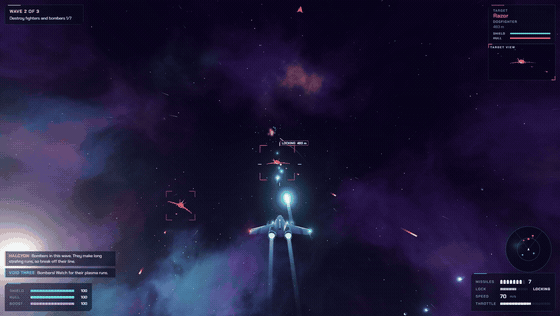

*Every clip and screenshot here is real gameplay from the finished build, captured frame by frame
at 60 fps while the test script flew the mission with real mouse and keyboard input.*

---

## What it looks like

| | |
| --- | --- |
| 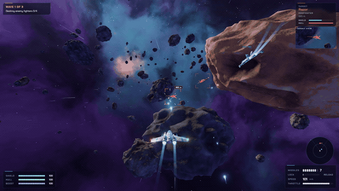 | 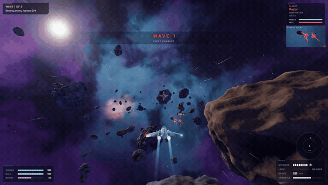 |
| **Missile lock.** Keep a target centred and the lock builds on its own; fire when the tag turns green. | **The belt.** Rocks split when you shoot them, and flying into one hurts. |
| 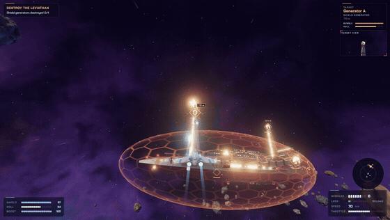 | 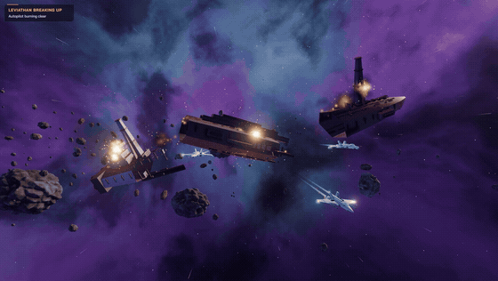 |
| **The Leviathan.** Its generators sit on pylons outside the shield bubble. | **The finale.** Four generators down and the carrier comes apart in three pieces. |

Full-HD stills from the final build:

| | |
| --- | --- |
| 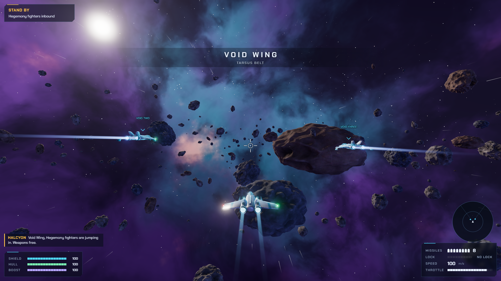 | 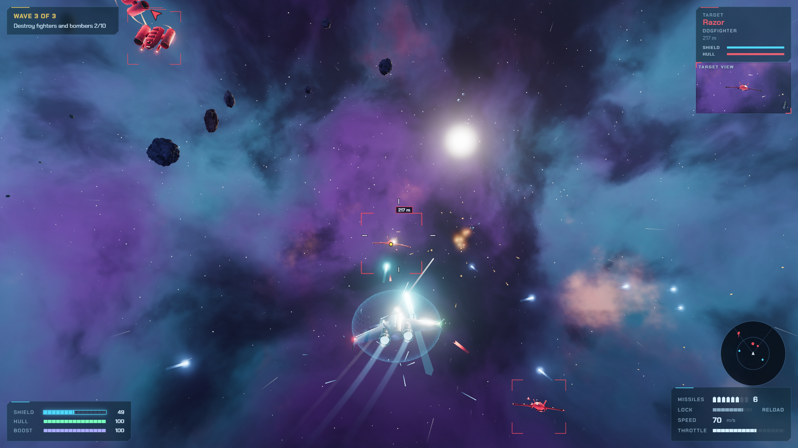 |
| 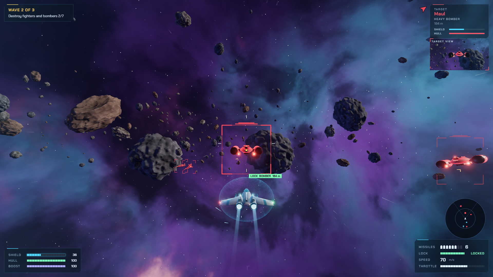 | 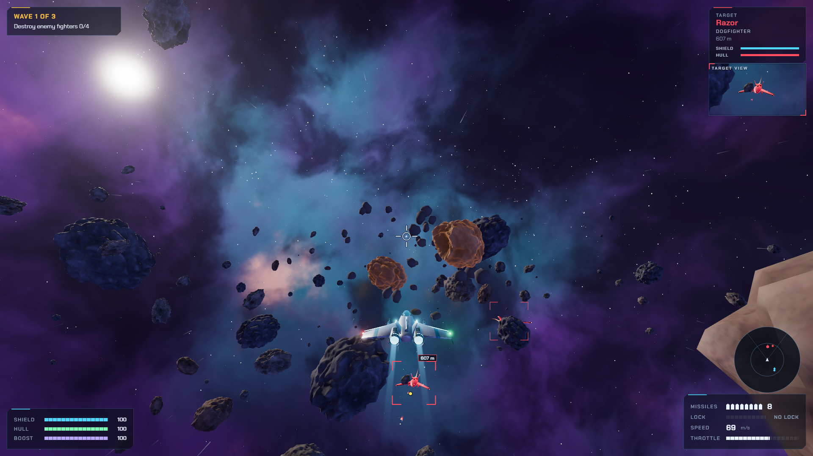 |
| 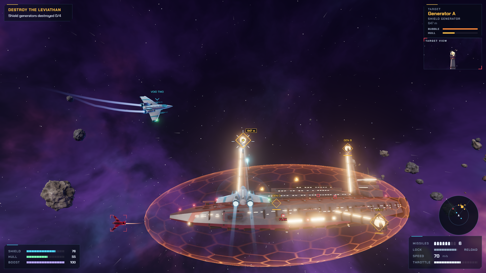 | 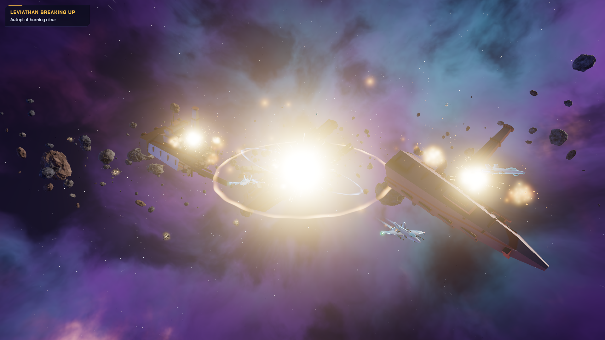 |

---

## How to play

Open **[voidwing.pages.dev/play](https://voidwing.pages.dev/play/)** in Chrome, Edge or Firefox on a
desktop or laptop. Click **Launch mission** (or press Enter), then click the game once so it can
capture the mouse. A run takes about ten minutes.

### Controls

| Input | Action |
| --- | --- |
| Mouse | Steer: the ship turns toward the white ring |
| Left mouse (hold) | Lasers |
| Right mouse or F | Fire a missile once the lock tone goes solid and the target shows a green LOCK tag |
| W / S | Throttle up / down |
| A / D | Roll left / right |
| Shift or Space | Boost (drains the boost meter) |
| Tab | Next target |
| Esc or P | Pause (settings and the flight guide are in the pause menu) |

### Tips

- **Steer with the mouse.** The white ring is where you are steering; the ship turns toward it and
  the white cross, where your guns point, swings onto it.
- **Lead your shots.** A moving target shows a yellow dot. Put the white cross on the dot and fire.
- **Missiles** lock by themselves while the target stays near the middle of the screen. They rearm
  between waves, plus one every 20 seconds in combat.
- **Colours:** cyan is your side, red is the enemy, amber is an objective, orange is danger to you,
  green is your missile lock. A double bar over a red bracket marks a Maul bomber. Arrows at the
  screen edge point to things off screen; orange chevrons around your ship show where fire is
  coming from.
- **Shields** recharge a few seconds after you stop taking hits. Hull damage does not.
- **The carrier:** its shield bubble stops your shots, but the four generators sit outside it on
  pylons. If a generator's tag says SHIELD IN THE WAY, swing out until it clears. Stay out of its
  flak, which reaches just over a kilometre.
- **If you die** the mission fails; **Retry** starts you again at the wave you were on.

Difficulty (Cadet, Pilot, Ace), mouse sensitivity, invert Y, auto-level, graphics quality and
volume are in **Settings** on the title screen and in the pause menu. Cadet cuts enemy damage by almost half and makes their aim worse.

---

## Run it yourself

You need [Node.js](https://nodejs.org) 20 or newer. In PowerShell:

```powershell
cd "C:\path\to\voidwing"; npm install
```

```powershell
cd "C:\path\to\voidwing"; npm run dev
```

Then open http://localhost:5173. Leave the terminal open while you play; Ctrl+C stops the server.

| Command | What it does |
| --- | --- |
| `npm run dev` | Development server with hot reload |
| `npm run build` | Type-checks and builds the game into `dist/` |
| `npm run preview` | Serves the built `dist/` folder |
| `npm run site` | Builds the public site into `site-dist/`: the landing page at `/`, the game at `/play/` |
| `npm run site -- --deploy` | Builds the site and deploys it to Cloudflare Pages (project `voidwing`) |
| `npm run playtest -- --scenario win --god` | Headless self-test that flies the whole mission (see Testing) |
| `npm run media` | Cuts the recorded runs into the landing page clips and README GIFs (see Footage) |
| `npm run assets` | Rebuilds every 3D model from the Blender scripts (needs Blender 5.1) |

URL flags for trying things out: `?god` (you cannot die), `?phase=N` (jump to a mission phase),
`?seed=N` (asteroid layout), `?quality=auto|high|medium|low`, `?nosound`.

---

## How it was made

VOID WING was built by Claude (Opus 5.5) from a single prompt, as the first game in a five-game
test of one shared brief: Vite, TypeScript and Three.js, every model made in Blender, every sound
synthesized, and a self-test after every milestone. Nothing is downloaded at run time and there are
no asset files from anywhere else.

| Milestone | What it added | Critic rounds |
| --- | --- | --- |
| 1. Greybox | The whole loop in primitive shapes: fly, shoot, win and lose | 4 |
| 2. Assets | Ships, carrier, asteroids and ordnance modelled by script in Blender, exported as glTF | 2 |
| 3. Feel | Camera, particles, trails, screen shake, hit feedback, sound and music | 6 |
| 4. Interface | Title, HUD, pause, failure and victory screens in one designed look | 11 |
| 5. Polish | Steady 60 fps, a rebuilt carrier, readable targets at range, no console errors | 9 |

**The critic loop.** After each milestone, `scripts/playtest.mjs` played the game in headless
Chromium and saved screenshots from the player's camera. A separate reviewer that saw only those
screenshots and a one-paragraph pitch, never the code or the reasoning, listed the five worst
problems a player would notice. They were fixed and the loop ran again. The reports are in
[`docs/critic/`](docs/critic) and the progress shots from each milestone in
[`docs/progress/`](docs/progress). The design decisions, with the reason for each, are logged in
[`CLAUDE.md`](CLAUDE.md).

- **Stack:** Vite, TypeScript and Three.js (WebGL2), with an HDR post chain (MSAA, bloom, ACES
  tone mapping).
- **3D models:** one Python script per asset family in `blender_scripts/`, exported to
  `public/assets/` as `.glb`, including a low-poly copy of each asteroid for distant rocks.
  `npm run assets` regenerates them with Blender running headless (set `BLENDER_PATH` if Blender is
  not in the default location).
- **Textures** are procedural: baked in Blender from shader nodes, or generated in shaders at run
  time (nebula, starfield, shields, particles and the carrier's hull panelling).
- **Audio** is Web Audio synthesis: an effects engine with voice limiting and a generated reverb,
  and a step sequencer playing title, combat and boss music plus victory and defeat stingers. There are no sound files.
- **Font:** Chakra Petch (SIL Open Font License), bundled through `@fontsource`.

### Graphics and performance

The game targets a steady 60 fps on a mid-range laptop. **Graphics: Auto** (the default) starts at
High and steps down a level if the frame rate stays below about 54 fps while you fly.

| Level | Resolution cap | Anti-aliasing |
| --- | --- | --- |
| High | device pixel ratio up to 1.5 | 4x MSAA |
| Medium | 1.0 (native CSS pixels) | 2x MSAA |
| Low | 0.75 | off |

Every shader is compiled while the loading screen is up, so the first bomber, the carrier and the
first big explosion never stall a frame. Far asteroids draw a low-poly copy, which keeps the belt
to about 240k triangles and 130 draw calls at the busiest moments. In the headless self-test on a
desktop GPU the game averages 60 fps at 1280x720 and 1920x1080.

---

## Testing

`npm run playtest -- --scenario <name>` starts the game in headless Chromium, flies it with real
mouse and keyboard input, saves screenshots from the player camera and writes `report.json`
(frame rate, draw calls, console errors) to `test-output/`.

| Scenario | What it does |
| --- | --- |
| `win` | Flies the whole mission to the victory screen (add `--god` so the bot cannot die) |
| `lose` | A passive pilot that gets shot down, then presses Retry |
| `ui` | Pause menu, flight guide and settings |
| `showcase` | Boosts, then splits an asteroid close up |
| `smoke` | Loads the game and launches the mission |

Add `--preview` to test the production build, and `--width 1920 --height 1080` for full-HD shots.

## Footage

The clips on the landing page and the GIFs above come from **film mode**: `--film` swaps the page's
clock for a virtual one, then steps the game one 1/60 s frame at a time and captures every frame
into an MP4. Capturing a 1080p frame takes longer than 1/60 s, but the game never sees that, so the
footage plays back at a smooth 60 fps. Each screenshot label in the run is saved with its frame
number, and `scripts/make-media.mjs` cuts the clips at those labels, so a new recording re-cuts
itself.

```powershell
cd "C:\path\to\voidwing"; npm run playtest -- --scenario win --god --preview --film --quality high --width 1920 --height 1080 --out test-output/film-win
```

```powershell
cd "C:\path\to\voidwing"; npm run playtest -- --scenario showcase --preview --nobuild --film --quality high --width 1920 --height 1080 --out test-output/film-showcase
```

```powershell
cd "C:\path\to\voidwing"; npm run media
```

The encoder is `ffmpeg-static` from npm; if your npm blocks install scripts, run
`npm approve-scripts ffmpeg-static` once.

## Project layout

```
src/core          renderer, input, math
src/game          ships, AI, weapons, asteroids, capital ship, mission director, world
src/render        asset loader, camera rig, sky, particles, trails, shields, quality levels
src/audio         synthesized sound effects and the music sequencer
src/ui            HUD, menus and screens, styles
src/debug         test hooks for the Playwright self-test
blender_scripts/  one Python script per asset family
public/assets/    exported .glb models
site/             the landing page (static HTML, CSS and JS) and its clips in site/media/
scripts/          playtest.mjs (self-test and film mode), make-media.mjs, build-site.mjs, build-assets.mjs
docs/             critic reports, progress shots per milestone, README GIFs in docs/media/
screenshots/      final full-HD player-view screenshots
```

## Changelog

**1.0.0 (25 September 2026).** First release: the full mission (three waves and the carrier),
Cadet, Pilot and Ace difficulties, Auto, High, Medium and Low graphics, the landing page, and the
public site on Cloudflare Pages.

## Licence

The game code and assets in this repository were made for this project. Chakra Petch is licensed
under the SIL Open Font License 1.1.
